# 判定・消去・描き直しの検証（最初のマイルストーン）

- 検証した日: 2026-11-12
- 対象: [Packages/BarlessKit](../Packages/BarlessKit)（`DeviceCatalog` / `StatusBarAnalyzer` / `InpaintEngine` / `StatusBarRenderer` / `ImageIOKit`）
- 使った画像: Simulator で撮った 164 枚（16 機種 × iOS 18.6 / 26.5 / 27.0〈機種によっては無い組み合わせがある〉× 4 つの状態）と、実機（iPhone 16 Pro Max・iOS 27.2）の 2 枚。どれも上端 72〜80pt の切り出し。iPhone Duo の 4 枚は自動判定の対象外
- 数値の表は [verification/results.md](verification/results.md)（自動生成）、画像は [verification/images/](verification/images/)
- 作り直し方: `Tools/statusbar/make-verification-report.sh`（[Tools/statusbar/README.md](../Tools/statusbar/README.md)）
- macOS（`swift test`）と iOS Simulator（iOS 26.5）で同じ数値になることを確かめた（違うのは文字認識にかかる時間だけ）
- 2026-11-12 に、帯を横切る背景の輪郭の扱い（§3-5）を足した

仕様書（非公開のリポジトリ `shilokuma-inc/barless-spec`）の §5-2・§5-3 で不安だった 2 点、「スクショの大きさだけでは配置が決まらないのに、機種と iOS の世代を決められるか」と
「消して描き直した結果が、本物の表示とどれくらい合うか」を確かめた。

## 0. 結論

| 項目 | 結果 |
| --- | --- |
| 機種グループ × iOS の世代の判定（単色の背景） | **125 枚すべて正解**。時刻の文字列が読めなくても同じ |
| 同（ホーム画面の壁紙） | 41 枚中 39 枚が正解。残り 2 枚は「決められない」になり、**誤った配置に決めた画像は 0** |
| 文字認識で時刻を読む | 166 枚すべて読めた（時刻のまわりだけを切り出して 3 倍に拡大して渡す） |
| 消去（単色の背景） | 125 枚すべて、消した後の帯が背景の色と完全に同じ（差 0） |
| 消去（グラデーションの背景） | 縦・横・斜め・円形とも、元の背景との差は最大 1/255 |
| 消去（JPEG で保存し直した画像） | 判定は変わらない（品質 0.7 まで全問正解）。文字のまわりに薄いにじみが残る（品質 0.7 で最大 21/255） |
| 消去（輪郭が帯を横切る背景） | 輪郭が文字もアイコンも無い所を通るなら、輪郭に触らない（48 枚すべて差 0）。電池の後ろを通るなら、配置が決まった画像すべて（斜めの輪郭 32 枚・縦の輪郭 48 枚）で「跡が残りそう」と伝える |
| 描き直し（自作ベクター）と本物の重なり | 平均 0.85〜0.99（要素・世代による）。インクの範囲の辺のずれは最大 2px（3 倍の画像で 0.7pt） |

**分かったこと（仕様・設計に返す点）**

1. **時刻の位置と大きさだけでは iOS の世代が決まらない機種がある**。iPhone 11・11 Pro・11 Pro Max・SE は、iOS 18〜26 と 27 で時刻がまったく同じ位置・同じ大きさで、
   違うのはアイコンの形だけ（iOS 27 は電池が枠なしのカプセル形になる）。これらは**電池の形**で世代を決めるようにした（§2-2）。
   この方式は 2026-11-12 に承認され、仕様書 §5-2 に「大きさ → 時刻の位置と大きさ → 電池の形」の順として反映した
2. iOS 27 は、位置が変わらない古い機種でもアイコンの形が変わる。配置は必ず「機種グループ × iOS の世代」で持つ（25 件になった）
3. アイコンの形は比率の決め打ちでは合わない。電波の棒 4 本・Wi-Fi の 3 つの帯・電池の本体と突起をカタログで実測して、それに合わせて描く
4. 時刻は中央ぞろえで、9:41 の実測から 23:58 の位置を 2px 以内で見込める。ただし文字列が変わると中心が 1px ほど揺れる

**うまくいかない条件**（詳しくは各節）

- 時刻のすぐ後ろを輪郭が横切る背景（iPhone SE のホーム画面で、ウィジェットの縁が時刻にかかる 2 枚）→ 判定は「決められない」
- カタログに無い大きさ（リサイズされた画像）と iPhone Duo → 自動では扱わない。手動調整の画面が要る
- 輪郭（建物の縁など）が文字・アイコンの後ろを通る背景 → その文字・アイコンの範囲で輪郭がぼやける。「跡が残りそう」と伝えるようにした（§3-5）
- 文字と背景の差が小さい画像（白い文字 × 明るい写真 など）→ 薄い消し残りが出るが、今は見分けていない（§3-4）
- 再圧縮された画像 → 消した後に薄いにじみが残る
- 描き直しで未対応のもの: キャリア名（SE）、電池の % 表示、5G / 4G、機内モード、位置情報の矢印、「文字を太くする」設定（§4-4）

## 1. 作ったもの（処理の流れ）

```
スクリーンショット
  │  大きさ（px）で DeviceCatalog から候補を引く（1 つの大きさに 1〜3 件）
  ▼
帯の中のインクを拾う … 帯のすぐ上とすぐ下の行を背景とみなし、その間を直線で補間した色との差が大きい画素
  │  時刻のまわりだけを切り出して 3 倍に拡大し、Vision で時刻の文字列を読む
  ▼
候補ごとに「その配置で同じ時刻を描いたら、どこにインクが載るか」を計算し、画像から測った矩形と比べる
  │  差が付かない機種（iPhone 11 系・SE）は、電池の形（枠の内側にすき間があるか）で iOS の世代を決める
  ▼
配置が決まる（決まらなければ「決められない」→ 手動調整へ）
  │  インクの画素を 1pt 広げてマスクにする
  ▼
消去 … 単色: まわりの色で塗る ／ それ以外: 同じ行の左右・同じ列の上下の背景から補間する
  ▼
描き直し … 時刻はシステムフォントの輪郭、電波・Wi-Fi・電池は自作のベクターを、カタログの実測の位置に描く
```

- `DeviceCatalog` の JSON は、実測（[device-table.json](device-table.json)）とフィクスチャの画像から `Tools/statusbar/make-catalog.py` が作る。
  同じ大きさ・同じ iOS の世代で、要素の位置と大きさの差が 1pt 以内の実測を 1 つの配置にまとめ、同じ大きさでも配置が違う機種は別の機種グループにする
  （例: 1206×2622 は iPhone 17 が `1206x2622-a`、iPhone 18 Pro が `1206x2622-b`）
- 実機の iPhone 16 Pro Max（1320×2868）は、Simulator の iPhone 18 Pro Max と配置が違うので、別の機種グループとして入れてある

## 2. 検証 1: 判定

### 2-1. 結果

| 画像 | 枚数 | 正解 | 決められない | 誤った配置 |
| --- | --- | --- | --- | --- |
| 設定アプリ（単色）・ライト・9:41 | 41 | 41 | 0 | 0 |
| 設定アプリ（単色）・ライト・23:58 | 41 | 41 | 0 | 0 |
| 設定アプリ（単色）・ダーク・9:41 | 41 | 41 | 0 | 0 |
| ホーム画面（壁紙）・9:41 | 41 | 39 | 2 | 0 |
| 実機（iPhone 16 Pro Max・iOS 27.2）ライト / ダーク | 2 | 2 | 0 | 0 |

- 時刻の文字列を渡さない場合（文字認識に失敗した想定。時刻の高さと中心だけで比べる）も、まったく同じ結果になった
- グラデーションの背景（§3）と、JPEG で保存し直した画像（品質 0.7 まで）でも、判定は変わらなかった
- Unit テスト: `LayoutDecisionTests`（全 166 枚）、`TimeRecognitionTests`（文字認識を通す代表 8 枚。全部を読むのは `BARLESS_FULL_OCR=1`）

### 2-2. 分かったこと

**時刻で決まる機種（118 枚）**
- 1 位と 2 位の候補の「時刻のずれ」（4 辺の差の合計）の差は、最小でも 2.0pt、中央値は 16.3pt。決めるしきい値（1.0pt）に対して余裕がある
- ノッチの機種は iOS 27 で時刻が約 10pt 右に寄るので大きく離れる。Dynamic Island の機種は位置がほぼ同じで、文字が 1pt ほど大きくなる差で決まる（いちばん余裕が小さい組）
- 同じ大きさで機種が違う組（iPhone 17 と 18 Pro、実機の 16 Pro Max と 18 Pro Max）は、時刻の左右の位置が 7pt ほど違うので迷わない

**時刻では決まらない機種（46 枚）**
- iPhone 11・11 Pro・11 Pro Max・SE は、iOS 18〜26 と 27 で時刻の矩形がまったく同じ。違いは右側のアイコンで、位置の差は 1pt 以内だが**形が変わる**
- 電池の左端から中へ進んだとき、「塗り（枠）→ 途切れ（すき間）→ 塗り（中身）」と並んでいれば iOS 18〜26、塗りが続いていれば iOS 27（カプセル形）と決める
- iOS 27 でも残量が少ないと、左端の近くで「残量の色 → 空いている部分の薄い色」と差が下がる。途切れた後に塗りへ戻るかまで見ないと、背景の色によっては iOS 18〜26 と取り違える（レビューで見つかった。残量 5%・12%・50%・100% を 6 通りの背景に描いた画像のテストを足してある）
- すき間があるかは、背景との差の絶対値ではなく「それまでの最大との比」で見る。絶対値で見ると、JPEG で保存し直した画像で iPhone 11・SE を iOS 27 と誤った（品質 0.9 でも 125 枚中 6 枚）

**時刻の位置の見込み（中央ぞろえ）**
- 9:41 の実測からフォントの大きさと中心を求め、23:58 を同じ中心に組むと、実測の 23:58 と 4 辺とも 2px 以内で合った（24 配置すべて。[results.md](verification/results.md) §3）
- フォントはシステムフォントの semibold。太さを変えて画素ごとに比べても semibold がいちばん合った
- 文字列が変わると中心が 1px ほど揺れる（どちらに寄るかは機種でまちまち）。位置は 9:41 の実測に合わせ、大きさは 9:41 と 23:58 の両方に合うものを選んでいる

**文字認識**
- 帯全体（幅 1200px ほど、文字の高さ 36px ほど）をそのまま Vision に渡すと、ダークの 2 枚で時刻を見落とした
- 時刻がありそうな範囲（候補の配置の実測を左右 24pt・上下 8pt 広げた範囲）だけを切り出して 3 倍に拡大すると、166 枚すべて読めた。
  1 枚あたり macOS で 0.15 秒、iOS Simulator で 0.43 秒（文字認識 + 判定。実機では未計測）

### 2-3. うまくいかない条件

| 条件 | どうなるか | 対応 |
| --- | --- | --- |
| 時刻のすぐ後ろを輪郭が横切る（iPhone SE のホーム画面。ウィジェットの縁が時刻にかかる） | 時刻のインクと背景の輪郭が 1 つのかたまりになり、「決められない」になる（2 枚） | 手動調整へ回す。誤った配置に決めるよりよい |
| カタログに無い大きさ（SNS やメッセージアプリでリサイズされた画像） | `unknownSize` を返す | 手動調整。縦横比から候補を出す処理は未実装 |
| iPhone Duo（1398×2034） | `unsupported` を返す | 時刻などが縦に並ぶ別の配置なので、MVP では手動調整 |

未確認のもの（Simulator では撮れない・今回は撮っていない）:
- 実機の iPhone XS・XR、拡大表示、「文字を太くする」設定
- 時刻の横に何かが出ている画像（位置情報の矢印、集中モードのマーク、画面収録の赤いマーク）。時刻と 1 つのかたまりになる可能性がある
- Dynamic Island にライブ表示が出ている画像
- ステータスバーのすぐ下まで別の内容が来ている画面（インクの下 3pt の行を背景の基準にしているため）

## 3. 検証 2: 消去

### 3-1. 方法

- **インクを拾う**: 帯のすぐ上（インクの上 3pt）とすぐ下（下 3pt）の行を背景とみなし、列ごとにその 2 点を直線でつないだ色を「背景の見込み」にする。
  見込みとの差（3 チャンネルの合計）が 60 を超える画素がインク。縦方向に直線的に変わる背景なら、単色でなくてもインクだけが残る
- **マスク**: インクの画素を上下左右に 1pt 広げる（縁のにじみまで覆う）。背景の輪郭を拾ったインクは、文字・アイコンの外では外す（§3-5）
- **単色**（`SolidFillInpainter`）: マスクのまわりの色の中央値で塗る
- **それ以外**（`GradientInpainter`）: マスクされた画素を、同じ行の左右と同じ列の上下にある背景の画素から 1 次補間し、切れ目が短いほうを重く見て混ぜる

### 3-2. 結果

| 背景 | 枚数 | 消した後と、インクが無い背景との差 |
| --- | --- | --- |
| 単色（設定アプリ・実機） | 125 | 最大 0（完全に同じ） |
| 縦・横・斜めのグラデーション | 各 48 | 最大 1/255（丸めの誤差） |
| 円形のグラデーション（直線的でない） | 48 | 最大 1/255 |
| JPEG で保存し直した単色（品質 0.9 / 0.7 / 0.5） | 各 125 | 最大 11 / 21 / 30（平均は 0.5〜0.9） |
| ホーム画面（壁紙） | 41 | 正解の画像が無いので数値は無し（下の画像） |
| 斜めの輪郭が、文字もアイコンも無い所を通る背景 | 48 | 最大 0（輪郭に触らない） |
| 斜めの輪郭が、電池の後ろを通る背景 | 48 | 配置が決まった 32 枚で最大 100（電池の範囲で輪郭がぼやける）。残り 16 枚は「決められない」 |
| 縦の輪郭が、電池の後ろを通る背景 | 48 | 最大 78（電池の幅で輪郭がにじむ） |

- グラデーションは、作った背景に Simulator のインクを移した画像で測った（背景との差をそのまま足して移しているので、入力の画像では電池の緑が暗く写る。消去の結果には関係しない）
- Unit テスト: `EraseVerificationTests`、`InpaintEngineTests`

### 3-3. 画像

どの画像も、時刻とアイコンのまわりだけを切り出して上から順に積んである。

**斜めのグラデーション**（上から: 入力 / 消去後 / 元の背景 / 消去後と背景の差〈白は差なし〉/ 描き直し）

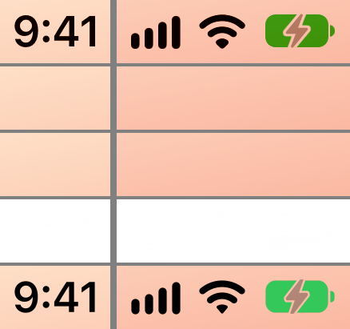

**円形のグラデーション**

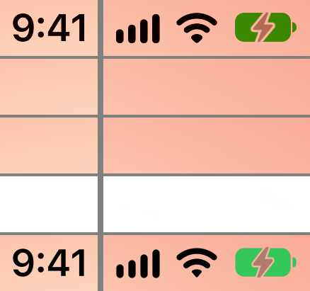

**ホーム画面（壁紙）**（上から: 入力 / 消去後 / 描き直し）

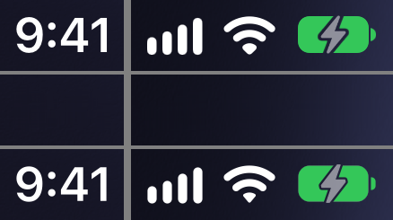

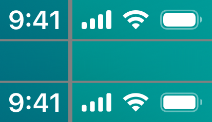

**うまくいかない例: iPhone SE のホーム画面**（ウィジェットの縁が時刻のすぐ後ろを横切り、配置が決まらないので入力だけ）

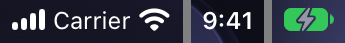

### 3-4. うまくいく条件・いかない条件

| | 条件 |
| --- | --- |
| うまくいく | 単色。縦・横・斜め・円形のグラデーション。なめらかに変わる壁紙（Simulator の標準の壁紙で確認） |
| 跡が残る | **輪郭が文字・アイコンの後ろを通る**: その文字・アイコンの範囲で、輪郭がぼやける。「跡が残りそう」と伝える（§3-5） |
| 跡が残る | **模様・写真**: 背景の見込み（縦の直線補間）が外れ、背景の一部までインクとして拾う。背景の種類を「複雑」と判定したときは「跡が残りそう」と伝える |
| 跡が残る | **再圧縮された画像**: 文字のまわりのにじみが 1pt より外まで広がっていて、薄く残る（品質 0.7 で最大 21/255）。広げる幅を増やせば減らせる |
| 拾えない | 文字と背景の差が小さい（3 チャンネルの差の合計が 60 以下）。白い文字 × 明るい写真など |

- 背景の種類の判定（単色 / グラデーション / 複雑）は、壁紙の 39 枚をすべて「グラデーション」とする。帯の全体を見る判定なので、
  帯の一部だけを横切る輪郭は「複雑」にならない。輪郭は、背景の種類とは別に見分けている（§3-5）
- **薄い消し残りは見分けていない**: 文字と背景の差が小さい（3 チャンネルの差の合計が 60 に近い）と、インクの一部を拾えず、薄く残る。
  手元の写真で作った画像では、黒い文字 × 暗い写真・白い文字 × 明るい空で起きた。注意も出ない
- 写真・壁紙の背景をきれいに消すのは Phase 2（LaMa）の範囲。`Inpainter` プロトコルを `async` にして、差し替えられるようにしてある

### 3-5. 帯を横切る背景の輪郭

建物の縁や壁紙の模様のような輪郭が帯を斜めに横切ると、背景の見込み（上下の行の直線補間）がその列で外れ、輪郭の一部をインクとして拾う。
前は、拾ったインクをすべて消していたので、次の 2 つが起きていた。

- 文字もアイコンも無い所の輪郭が、小さくぼやける（iOS 26・27 のホーム画面の壁紙で起きていた）
- 輪郭が文字・アイコンの後ろを通ると、まわりの輪郭まで広くぼやける。背景の種類は「グラデーション」のままなので、注意も出ない

**見分け方**

- **斜めの輪郭**: 文字とアイコンは、帯の端（背景の基準にする行）から 3pt 離れている。帯の上端か下端から 1pt 以内まで届いている、
  ひと続きのインクのかたまりは、帯の外の背景から続いている輪郭とみなす（`InkScan.structure`）
- **縦の輪郭**: まっすぐ縦に通る輪郭は、上下の基準の行で色が同じなので、インクとしては拾えない（余計な所を消すこともない）。
  その代わりに、基準の行で 1pt 離れた画素の色の差（3 チャンネルの合計）が 200 以上の列を覚えておく（`InkScan.edgesAbove`・`edgesBelow`）

**扱い**

- 輪郭を含むかたまりのうち、文字・アイコンの範囲（実測の矩形を 2pt 広げたもの）の外にあるインクは、消さない
- 輪郭が、文字・アイコンの範囲の中に 4pt² 以上あれば「跡が残りそう」と伝える（`StatusBarAnalysis.mayLeaveTraces`。背景の種類が「複雑」のときも同じ）
- 帯のすぐ上の行とすぐ下の行の両方で、同じ文字・アイコンの列に色の大きな変化があるときも、縦の輪郭が後ろを通っているとみなして、同じように伝える

色の差のしきい値 200 は、縦の輪郭の左右の差を変えて測って決めた。差が 180 までは跡が見える画素（差の合計が 48 超）が 4 以下で、270 で 100 を超える。
既存の画像（単色・再圧縮・壁紙）で、上下の両方に 200 以上の変化があるものは無い（配置が決まった画像での最大は 9）。

**結果**（数値は [verification/results.md](verification/results.md) の 4-3・4-5）

| 画像 | 枚数 | 結果 |
| --- | --- | --- |
| 単色の背景・グラデーション・再圧縮 | 125・192・375 | 注意は 0 枚。判定も消去の結果も変わらない（輪郭を拾ったのは、品質 0.5 で再圧縮した 1 枚の数画素だけで、消去には影響しない） |
| ホーム画面（壁紙） | 配置が決まった 39 | 28 枚（iOS 26.5 と 27.0）で輪郭を拾い、消さずに残した。注意は 0 枚 |
| 作った輪郭が、文字もアイコンも無い所を通る | 48 | 48 枚すべて、消した結果が背景と完全に同じ。注意は 0 枚 |
| 作った輪郭が、電池の後ろを斜めに通る | 48 | 配置が決まった 32 枚すべてで注意あり。16 枚は「決められない」（下の注） |
| 作った輪郭が、電池の後ろを縦に通る | 48 | 48 枚すべてで注意あり |

- 電池の形で iOS の世代を決める機種（iPhone 11・11 Pro・11 Pro Max・SE）は、斜めの輪郭が電池の後ろを通ると電池の形が読めず、「決められない」になる（誤った配置にはしない）
- 手元の写真 12 枚（街・料理・植物など）に、確認用のステータスバーを描いた画像でも確かめた（写真はリポジトリに入れていない）。
  輪郭が電池の後ろを通る街の写真は、4 通りすべてで注意が出て、跡が見える画素は 4〜6 割に減った。輪郭の無い写真では、注意は増えていない
- Unit テスト: `StructureDetectionTests`

**電池の後ろを斜めに通る輪郭**（上から: 入力 / 消去後 / 元の背景 / 消去後と背景の差〈白は差なし〉。輪郭のまわりだけを切り出してある）

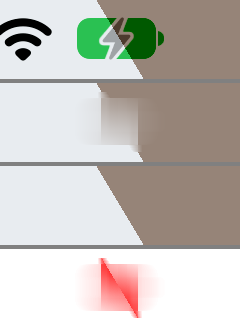

**電池の後ろを縦に通る輪郭**

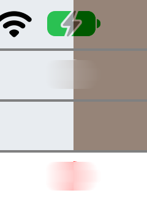

**文字もアイコンも無い所を通る輪郭**（消去後が背景と同じなので、差は真っ白）

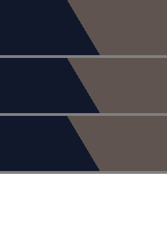

### 3-6. 手動調整（配置が分からない画像。2026-11-12 に追加）

機種を判定できない画像（SNS などで保存し直して大きさが変わったスクリーンショット）は、利用者が合わせた帯（画像の上端から n 行）だけを
手がかりに隠す（`ManualEditor`）。配置を使わないので、描き直し（「整える」）はできない。埋め方は 3 つ。

| 埋め方 | 中身 |
| --- | --- |
| 自動 | 帯の中の文字とアイコンを拾って、まわりの背景で埋める（単色なら 1 色、それ以外は補間）。自動の判定と同じ方法 |
| 色を拾う | 帯の全体を、画像から拾った 1 色で塗る |
| ぼかす | 帯の全体をぼかす（半径は帯の高さの 1/3。帯の中の画素だけを読む） |

「自動」が、自動の判定と違うところ:

- **基準の行**: 帯のいちばん上の行と、いちばん下の行。帯のすぐ下の行を使わないのは、線をちょうど色の境
  （ステータスバーの下で背景の色が変わるアプリ）に合わせたときに、境の下の色を背景と見込まないため
- **文字の色**: 白か黒を選ぶと、背景より明るい（暗い）インクだけを消す。背景の模様を巻き込みにくくなる
- **背景の輪郭も消す**: 文字・アイコンの位置が分からないので、輪郭とつながったインクを残すと、ステータスバーが残ることがある。
  確実に隠すほうを優先し、輪郭を拾ったときは「跡が残りそう」と伝える
- **広げる幅は 2pt**（自動の判定は 1pt）: 保存し直した画像は、文字のまわりのにじみが 1pt より外まで広がっている。
  補間は、消す範囲のすぐ外の色から埋めるので、にじみが残っていると、文字の形の薄い跡になる
- **倍率**: 分からないので、短い辺を 390pt 前後とみなして 1〜3 で見込む（縁を広げる幅などに使う）

| 画像 | 結果 |
| --- | --- |
| 単色の背景 5 枚 × 帯の高さ 3 通り（インクの下端から 3・6・12pt 下） | 帯の中は背景と完全に同じ（差 0）。帯の下は 1 画素も変わらない |
| 縦のグラデーション | 背景との差は最大 2/255 |
| 再圧縮（JPEG・品質 0.7）した単色とグラデーション、3 枚ずつ | 残る差は最大 13/255（広げる幅が 1pt だと 19）。見て分かる差の画素は 0 |
| 細かい模様・輪郭が電池の後ろを通る背景 | 「跡が残りそう」と伝える |
| 文字の色に、写っていないほうの色を選ぶ | 何も変えない |
| 上端だけを切り出した画像と、画像の全体 | 帯の結果は同じ（調整の途中の表示 = 書き出す画像） |
| 最初に出す帯の高さ（画像の形から見込む） | カタログの全配置で、インクの下端から 3pt 以上、下になる |

手元の画像（リポジトリには入れていない）でも確かめた。縮めて JPEG にした設定画面（1080×2348）と iPhone SE（640×1138）は跡なし。
街の写真に確認用のステータスバーを描いた画像（1080×2348・JPEG）と壁紙（840×1826）は「跡が残りそう」が出て、「ぼかす」「色を拾う」で隠せる。
街の写真は、広げる幅が 1pt だと時刻とアイコンの輪郭が薄く残り、2pt で消えた。どの画像でも、帯の下は 1 画素も変わらない。

うまくいかない条件:

- **線が高すぎる**（文字を横切る）: 線より下の文字が残る。**線が低すぎる**（アプリの見出しなどが帯に入る）: それも消す。
  どちらも、調整の画面に出る結果を見て直す
- **輪郭が文字・アイコンにつながっている**: 輪郭ごとぼける。「ぼかす」か「色を拾う」に替える
- **ぼかす**: 文字とアイコンは読めなくなるが、色のむらとして位置は残る
- 扱う大きさは、縦横とも 200〜4096px（カメラの写真のような巨大な画像は対象外）

Unit テスト: `ManualEditorTests`・`BandBlurTests`

## 4. 検証 2: 描き直し

### 4-1. 方法

- **時刻**: システムフォント（semibold）の輪郭を塗る。大きさと位置はカタログの実測から求める（§2-2）。SF Pro のファイルは同梱しない
- **電波・Wi-Fi・電池**: 自作のベクター（SF Symbols は使わない）。位置と大きさはカタログの細部の実測に合わせ、形は iOS の世代で変える

| | iOS 18〜26 | iOS 27 |
| --- | --- | --- |
| 電波 | 角を少し丸めた棒 | 上下が半円の棒 |
| Wi-Fi | 端をまっすぐ切った扇形の帯 | 端が丸い弧 + 角を丸めた扇形 |
| 電池 | 枠 + すき間 + 中身 + 突起 | 枠のないカプセル形（空いている部分は薄い色）+ 突起 |

- 色は画像から測った。立っていない棒は文字色の 20%（iOS 27 は 25%）、電池の枠は 40%、突起は 50%、iOS 27 の電池の空いている部分は黒の 30%（ダークは白の 50%）、
  緑は (52, 199, 89)、赤は (255, 59, 48)（iOS 27 は (255, 56, 60)）
- 比べ方: 単色の背景の画像を消してから、**その画像に写っているのと同じ中身**を描き、元の画像（= 正解）と要素ごとに比べる。
  「重なり」は、背景と違う色の画素（インク）について、両方にある画素 ÷ どちらかにある画素（1 で完全に一致）

### 4-2. 結果

| 要素 | 重なり（平均） | 重なり（最小） | インクの範囲の辺のずれ（最大） |
| --- | --- | --- | --- |
| 時刻 | 0.87〜0.96 | 0.77 | 2px |
| 電波 | 0.95〜0.97 | 0.87 | 1px |
| Wi-Fi | 0.89〜0.92 | 0.84 | 1px |
| 電池（iOS 18〜26。枠あり） | 0.85〜0.90 | 0.70 | 1px |
| 電池（iOS 27。カプセル形） | 0.94〜0.99 | 0.92 | 1px |

- 世代・中身ごとの内訳は [results.md](verification/results.md) §5。498 件（125 枚 × 4 要素から、撮影の揺れで Wi-Fi が写っていない 2 件を除く）
- 実機（iPhone 16 Pro Max・iOS 27.2）の 2 枚は、時刻 0.96・電波 0.96・Wi-Fi 0.90・電池 0.99。Simulator と同じ程度に合う
- 色: 輪郭のにじみを除いた内側の画素で比べると、差は最大でも 8.4/255（時刻）、電池は 4.4/255 以下。残量 12%（赤）を充電中（緑）で描くと上限を超えることも確かめている
- Unit テスト: `RedrawVerificationTests`（重なりの下限、辺のずれ 3px 以内、色の差の上限）

### 4-3. 画像

上から: 正解（元の画像）/ 消去後 / 描き直し / 正解と描き直しの差（白は差なし、赤が濃いほど差が大きい）。差は輪郭の 1px に集まっている。

**iOS 18.6（iPhone 16・ライト・9:41）**

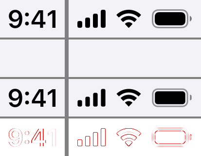

**iOS 27.0（iPhone 16・ライト・23:58・残量 12%）**

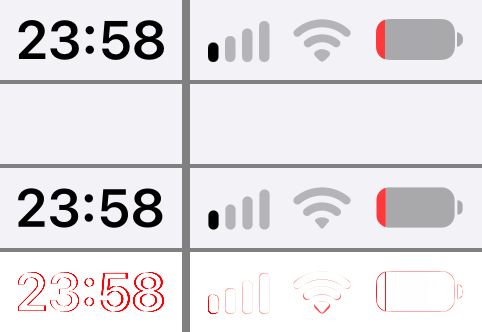

**iOS 27.0（iPhone 17・ダーク・充電中）**

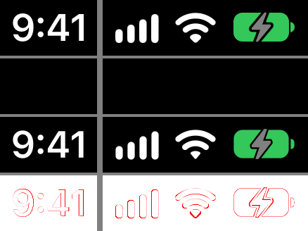

**実機（iPhone 16 Pro Max・iOS 27.2・残量 56%）**

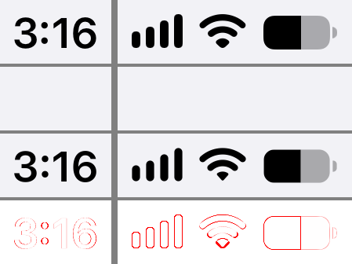

**「整える」の例**（iPhone 16・iOS 18.6）: 23:58・電波 1 本・残量 12% の画像を消して、9:41・電波最大・Wi-Fi 最大・満タンで描く。
上から: 入力 / 整えた結果 / 同じ機種で 9:41 を撮った画像（正解）/ 結果と正解の差

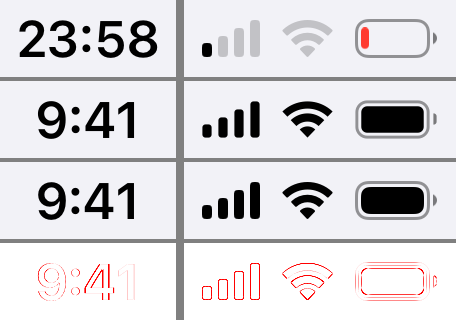

ほかの機種・状態は [verification/images/](verification/images/) にある（2 倍の機種の iPhone 11、ホームボタンの iPhone SE、iOS 26.5 の充電中 など）。

### 4-4. 合っていないところ・未対応のもの

| | 内容 |
| --- | --- |
| 時刻 | 文字列が変わると中心が 1px ほど揺れるので、23:58 では重なりが下がる（最小 0.77。2 倍の機種）。見た目では分からない程度 |
| Wi-Fi | 帯の端の形が少し違う（重なり 0.84〜0.92） |
| 電池（iOS 18〜26） | 枠が 1pt の細い線なので、わずかなずれでも重なりが下がる（残量が少ないと枠が大半を占め、最小 0.70） |
| 充電中の稲妻 | 形は Simulator の画像から起こした近似。iOS 26.5 と 27.0 で同じ形を使っている |
| 色 | 実機の画像（Display P3）は黒・白・灰色しか確かめていない。緑・赤・黄は未確認 |
| 低電力モード（黄） | 実測が無い（色は仮） |
| 未対応 | キャリア名（iPhone SE では消すだけで、描き直さない）、電池の % 表示、5G / 4G、機内モード、位置情報の矢印、「文字を太くする」設定 |

### 4-5. 「整える」での使い方（2026-11-12 に追加）

アプリの「整える」は、消したうえで、定番の表示（9:41・電波 4 本・Wi-Fi 最大・電池満タン。`StatusBarSpec.tidy`）を描き直す（`StatusBarEditor.edit`）。

- 残量 12%・電波 1 本・23:58 の画像を整えると、同じ機種の「9:41・満タン」の画像（= 正解）と、上の表と同じ下限以上で重なる
  （iPhone 16・11・13 mini・SE の iOS 18.6 で確認。iOS 26・27 の Simulator は満タンを「充電中」の緑で写すので、正解に使えない）
- **ホームボタンの機種（iPhone SE）**: 左に「電波・キャリア名・Wi-Fi」が並び、Wi-Fi の位置がキャリア名の長さで変わる。
  配置の実測は Simulator のキャリア名（Carrier）での位置なので、そのまま描くと、実機のキャリア名では Wi-Fi がずれる。
  そこで、キャリア名は消さずに残し、Wi-Fi はキャリア名の右端から、実測と同じすき間を空けて描く（`StatusBarAnalysis.tidyPlan()`）
  - キャリア名の右にある、Wi-Fi ほどの幅のかたまり（Wi-Fi、または 5G などの表示）は消して、Wi-Fi に描き直す
  - キャリア名が長くて、時刻との間に Wi-Fi が入らないときは、Wi-Fi を描かない
  - キャリア名を 2 つ並べて長くした画像で、Wi-Fi が元の位置（キャリア名の右）に重なることを確かめた。**実機のキャリア名では未確認**
- Unit テスト: `TidyTests`

### 4-6. 「遊ぶ」での使い方（2026-11-13 に追加）

アプリの「遊ぶ」は、消したうえで、時刻・電池・電波・Wi-Fi を好きな値に描き直す。解析と消去は 1 回だけ行い、
消した後の画像を持っておいて、値が変わるたびに、その上に描き直す（`StatusBarComposer`）。

- **「整える」と同じ中身で描くと、「整える」の画像と 1 画素も違わない**（単色・壁紙・ホームボタンの機種で確認）。
  描き直すたびに、消した後の上端の切り出しを重ねてから描く。消去は帯の中の画素だけを読み書きするので、
  上端だけを切り出して消しても、画像の全体を消したときと同じ結果になる
- **時刻を「そのまま」にすると、時刻のあたりは元の画像と完全に同じ**（差 0）。時刻の範囲だけを消去から外した画像を、別に持っている
- 時刻を隠す・Wi-Fi をオフにすると、その範囲は「隠す」の画像と同じ。電池・電波・Wi-Fi の値を変えると、その要素の範囲だけが変わる
- 帯の下は、どの中身でも 1 画素も変わらない
- ホームボタンの機種では、「整える」と同じく、キャリア名を残して、Wi-Fi をその右に描く
- 時刻の文字列は、端末の地域の書き方に合わせる（米国は `9:41`、日本は `9:41`・`14:08`、英国は `09:41`。午前・午後は付けない）

- 無料では、自由に決めた値（「整える」に無い値）を含む画像の右下に、透かし（小さなアプリ名。`WatermarkRenderer`）を載せる。
  下の画像の明るさを見て、黒か白の半透明の文字にする。ステータスバーの帯と、透かしの文字の範囲の外は 1 画素も変えない

まだ描けないもの: 電池の % 表示・充電中・低電力モード（充電中と低電力は描画にはある。画面からはまだ選べない）、電波の表記（5G など）、キャリア名。
元の画像に写っている値（残量・本数）は読み取っていないので、最初の中身は「整える」と同じ値から始まる。

Unit テスト: `StatusBarComposerTests`

## 5. 今回の範囲に入れていないこと・次の候補

- **手動調整での候補の提示**: 手動調整（§3-6）は帯の高さだけで隠す。大きさが変わっただけの画像は、縦横比から機種の候補を出せば「整える」もできるが、未着手。
  縦に長い機種はどれも縦横比がほぼ同じ（0.460〜0.462）なので、縦横比だけでは決まらない。解析結果の全候補のずれ（`StatusBarAnalysis.candidates`）が使える
- **「ぼかす」「塗る」「切り取る」**: 「ぼかす」と 1 色で塗るのは、手動調整にだけ入れた。自動で判定できた画像にはまだ無い。入れたら、「跡が残りそう」のときに「ぼかす」を提案する（仕様書 §5-2）
- **薄い消し残りを見分ける**: 文字と背景の差が小さい画像で、消し残りが出ても注意が出ない（§3-4）。インクの濃さから見分けられそうだが、未着手
- **輪郭が文字・アイコンの後ろを通るときの消し方**: 今は範囲を狭めて注意を出すだけ。輪郭に沿って埋めるには、補間のしかたを変える必要がある
- **再圧縮された画像**: にじみの広がりに合わせて、マスクを広げる幅を変える
- **処理時間**: 原寸の書き出し 1 秒以内（仕様書 §5-6）の計測は未実施。パッケージの画像を扱うターゲットは Debug でも最適化をかけている
- **実機の追加の撮影**: XS・XR・12 mini・13、拡大表示、低電力モード、% 表示、機内モード、位置情報の矢印、Dynamic Island のライブ表示、再保存した画像（一覧は barless-spec の `research/real-device-checklist.md`）
- **時刻の当てはめ**: 今は実測の矩形（整数の px）から大きさと位置を求めている。カタログを作るときに画素単位で合わせ込んで値を持てば、1px の揺れを減らせる
